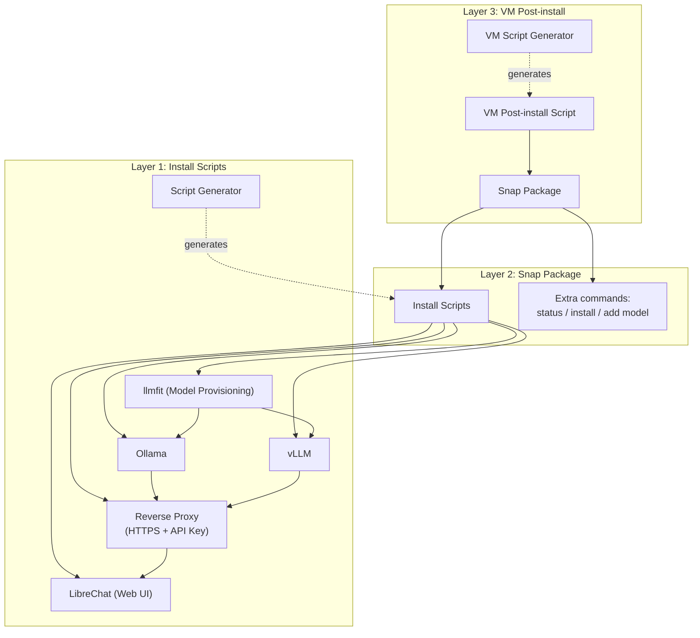

# All-in-one zero-conf local AI

This project is a wrapper of the best open-source AI tools available out there.

> **Status: early planning.** No code has been written yet — this README describes the intended design and roadmap, not a working tool. See [Roadmap](#roadmap) for what's built vs. planned.

## Features

Install AI models locally and access them through a web API with an API key.

Chat with your local AI models through a web interface.

Generate customized install scripts for your local server or your VMs (Virtual Machines).

## Requirements

Targeting Ubuntu/Debian with `snapd`, primarily for provisioning fleets of VMs. Other Linux distributions with snap support may work but aren't a design target yet.

## Architecture

How the layers and components fit together:

Each layer wraps the previous one and can be used on its own: install scripts alone for a single server, the snap package for a self-contained bundle, or the VM post-install layer for provisioning fleets of VMs.

## Project Layout

- [install_scripts](install_scripts/README.md) — Layer 1: install-and-configure scripts
- [snap_package](snap_package/README.md) — Layer 2: snap packaging
- [vm_script](vm_script/README.md) — Layer 3: VM post-install
- [generators](generators/README.md) — script generators shared by the layers above
- [search](search/README.md) — findings on candidate components and tools
- [docs](docs/README.md) — design decisions and write-ups
- [tests](tests/README.md) — tests validating scripts, package and VM provisioning
- [.github/workflows](.github/workflows/README.md) — CI workflows

## Components

### AI Inference Engines

Several AI inference engines are supported:

- Ollama
- vLLM

### Authentication

Some inference engines do not provide authentication nor HTTPS so a reverse proxy wraps them to provide HTTPS and an API Key access.

### AI Model Provisioning

- llmfit

### Chat Interface Websites

- LibreChat

## Layers

The project is organized by layers of increasing complexity. The previous layer is wrapped by the next one. Each layer can be used without the next ones.

### Install Scripts

Each component has an install script with some parameters to install and configure the component in one go.

A script generator helps you to generate parameterless install-and-configure scripts with fixed parameters.

### Snap Package

The snap package is wrapping everything in one package. Each install-and-configure script is reachable from the snap commands and each component's commands are mirrored by the snap.

Extra commands :

- `status`, listing what is currently installed and running
- `install`, installing a new component
- `add`, adding a new model in an inference engine, wrap it with the reverse proxy if needed and add it in the chat interface website

See [docs/snap-commands](docs/snap-commands.md) for the full command reference.

### Post-install script for VMs

Same as the install scripts but with the snap. One script with some parameters to install and configure the snap in one go and a generator script to generate some parameterless install-and-configure scripts with fixed parameters.

## Roadmap

Nothing is implemented yet — this is the first commit. Planned work, in dependency order:

| Layer | Item | Status |
| --- | --- | --- |
| Install scripts | Ollama install script | Not started |
| Install scripts | vLLM install script | Not started |
| Install scripts | llmfit install script | Not started |
| Install scripts | Reverse proxy (HTTPS + API key) | Not started |
| Install scripts | LibreChat install script | Not started |
| Install scripts | Script generator | Not started |
| Snap package | Core snap wrapping the above | Not started |
| Snap package | `status` command | Not started |
| Snap package | `install` command | Not started |
| Snap package | `add` model command | Not started |
| VM post-install | Post-install script | Not started |
| VM post-install | Script generator | Not started |
