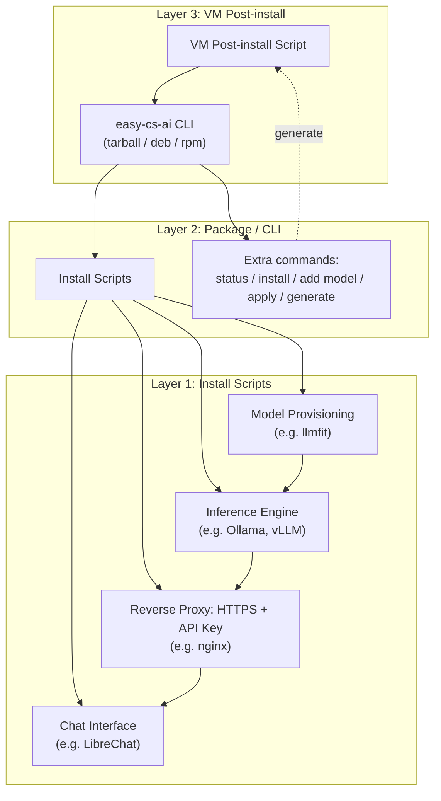

# All-in-one zero-conf local AI

This project is a toolbox that wraps the best open-source AI tools available out there.

> **Status: early development.** Ollama, llmfit, nginx (self-signed certificate) and LibreChat install, run and uninstall on an Ubuntu 24.04 VM (see [tests](tests/README.md#integration-tests-on-a-vm)), through the CLI (`status`, `install`, `uninstall`, `add`, `remove`, `apply`, `generate`) and the VM script generator. vLLM and AnythingLLM are not integrated yet, Debian, a GPU, and the `provided` and Let's Encrypt certificates are untested, and the `.deb`/`.rpm` release workflow has not been run yet. See [Roadmap](#roadmap) for what's built vs. planned.

Built on [Ollama](https://ollama.com), [LibreChat](https://www.librechat.ai), [llmfit](https://github.com/AlexsJones/llmfit) and [nginx](https://nginx.org), with [FerretDB](https://www.ferretdb.com) on [PostgreSQL](https://www.postgresql.org) for LibreChat's data, run by [Docker](https://www.docker.com). [jq](https://jqlang.org) is a dependency of the CLI; it is packaged with [nfpm](https://nfpm.goreleaser.com) and tested with [bats](https://github.com/bats-core/bats-core) and [ShellCheck](https://www.shellcheck.net). This project only wraps existing open-source tools, each installed from its own source and kept under its own licence; more are credited here as they are integrated.

## Features

Install AI models locally and access them through a web API with an API key.

Chat with your local AI models through a web interface.

Generate customized install scripts for your local server or your VMs (Virtual Machines).

## Getting started

What works today (tested on a throw-away Ubuntu 24.04 VM, CPU only): installing an inference engine (Ollama), the HTTPS and API key reverse proxy (nginx, self-signed certificate), a chat interface (LibreChat) and a first model, then using them. vLLM and AnythingLLM are not integrated yet.

You need an Ubuntu 24.04 machine (a VM is ideal), root access, internet access, and about 10 GB of disk and 6 GB of RAM for the default model.

**1. Install the CLI** from the [releases](https://github.com/Dimsi-BS/easy-cs-ai/releases) (a version marked *Pre-release* is a test version; check the exact version there):

```bash
VERSION=0.1.0-rc2
curl -fsSLO "https://github.com/Dimsi-BS/easy-cs-ai/releases/download/v$VERSION/easy-cs-ai_${VERSION}_all.deb"
curl -fsSLO "https://github.com/Dimsi-BS/easy-cs-ai/releases/download/v$VERSION/easy-cs-ai_${VERSION}_all.deb.sha256"
sha256sum -c "easy-cs-ai_${VERSION}_all.deb.sha256"
sudo apt install "./easy-cs-ai_${VERSION}_all.deb"
```

The `.rpm` and the `.tar.gz` are published next to it (see [docs/decision-packaging](docs/decision-packaging.md)); the scripts target Ubuntu/Debian. Installing the package only drops files: nothing is started.

The command is `easy-cs-ai`, and `ecsai` (**e**asy-**cs**-**ai**) is installed next to it as a short name: both run the same program, so `ecsai status` is `easy-cs-ai status`. The documentation uses the full name.

**2. Install the default stack and a first model** (llmfit, nginx, Ollama, LibreChat, then `llama3.2:3b`, about 2 GB to download):

```bash
sudo easy-cs-ai install --defaults
easy-cs-ai status
```

**3. Use it**

- Chat: open `https://<hostname>:8443` (the site is on port 8443 and the certificate is self-signed, so the browser warns once). **Registration is open: the first account becomes the administrator.** Close it afterwards with `sudo easy-cs-ai install chat-interface librechat --allow-registration false`.
- API: the models are served under `https://<hostname>/ollama-llama3.2-3b/v1` with the key of the proxy, which is created at install:

```bash
KEY="$(sudo easy-cs-ai component proxy nginx show-key)"
curl -k -H "Authorization: Bearer $KEY" "https://$(hostname)/ollama-llama3.2-3b/v1/models"
```

- Another model: `sudo easy-cs-ai add <model>` (llmfit checks that it fits the machine, then the model is served and offered in the chat). `sudo easy-cs-ai remove <model>` takes it away.

**4. Remove everything**: `sudo easy-cs-ai uninstall --all` (add `--purge` to delete the data too: models, databases, accounts).

For a fleet of VMs, `easy-cs-ai generate` asks a few questions and writes a post-install script that installs the package and the chosen stack on a new VM (`--config-only` writes the [configuration file](docs/spec-config.md) alone). All commands are in [docs/cli-commands](docs/cli-commands.md).

An AI agent with a shell can drive all of this for you: `easy-cs-ai guide` tells it how, `easy-cs-ai catalog --json`, `host --json` and `config validate <file> --json` give it what it needs, and `--json` always means one JSON document on stdout for programs, the human output otherwise (see [the journey](docs/spec-journey.md) and [renderings](docs/spec-rendering.md)).

## Requirements

Targeting Ubuntu/Debian, primarily for provisioning fleets of VMs sized with just the necessary resources. Other Linux distributions (`.rpm`, or the tarball with `bash` and `curl`) may work but are not a design target yet. Scripts are written in bash, see [docs/decision-scripting-language](docs/decision-scripting-language.md). Other design choices are listed in [docs](docs/README.md).

## Architecture

How the layers and components fit together:



Each layer wraps the previous one and can be used on its own: install scripts alone for a single server, the package/CLI for a self-contained bundle, or the VM post-install layer for provisioning fleets of VMs.

## Project Layout

- [install_scripts](install_scripts/README.md) — Layer 1: install-and-configure scripts
- [package](package/README.md) — Layer 2: package and CLI
- [vm_script](vm_script/README.md) — Layer 3: VM post-install script generator
- [search](search/README.md) — findings on candidate components and tools
- [docs](docs/README.md) — design decisions and write-ups
- [tests](tests/README.md) — tests validating scripts, package and VM provisioning
- [.github/workflows](.github/workflows/README.md) — CI workflows

## Components

### AI Inference Engines

Several AI inference engines are supported, in integration order (see [docs/decision-integration-order](docs/decision-integration-order.md)):

1. Ollama
2. vLLM

### Authentication

Some inference engines do not provide authentication nor HTTPS so a reverse proxy wraps them to provide HTTPS and an API Key access.

- nginx

### AI Model Provisioning

- llmfit

### Chat Interface Websites

In integration order, see [docs/decision-integration-order](docs/decision-integration-order.md):

1. LibreChat
2. AnythingLLM

## Layers

The project is organized by layers of increasing complexity. The previous layer is wrapped by the next one. Each layer can be used without the next ones.

### Install Scripts

Each component has an install script with some parameters to install and configure the component in one go. The scripts work on their own, without the CLI. There is no generator at this layer: chaining components and fixing their parameters is the job of the [configuration file](docs/spec-config.md) and `easy-cs-ai apply` (layer 2), see [docs/decision-vm-generator](docs/decision-vm-generator.md).

### Package / CLI

The `easy-cs-ai` CLI wraps everything in one package (tarball, `.deb` or `.rpm`). Each install-and-configure script is reachable from the CLI commands and each component's commands are mirrored by the CLI (`component`). It also includes the HTTPS and API Key wrapping.

Extra commands :

- `status`, listing what is currently installed and running
- `install`, installing a new component
- `uninstall`, removing a component (`uninstall --all` removes everything; `--purge` deletes the data too)
- `remove`, the reverse of `add`: unwiring a model and removing it from its inference engine
- `component`, the commands of one component, mirrored from its install script (`component engine ollama list-models`, `component proxy nginx show-key`); `component` alone lists the components of every type
- `exec`, the component's own program (`ollama`, `nginx`, `docker compose`…) run against the instance easy-cs-ai installed, with the variables and the Compose file of the installation (`exec engine ollama ps`): an expert command, outside the state and the journal
- `add`, adding a new model in an inference engine, wrapping it with the reverse proxy if needed and adding it to the chat interface website
- `apply`, interpreting a [configuration file](docs/spec-config.md) (components, options, models) to make the machine match it
- `generate`, the interactive generator of the layer 3 (VM post-install) script; `generate --config-only` writes the configuration file only
- `catalog`, `host`, `config schema`, `config validate` and `guide`, read-only commands that let an AI agent (or any program) discover what can be installed, what the machine is, what a configuration must look like and whether one is valid; with `--json`, one JSON document on stdout

See [docs/cli-commands](docs/cli-commands.md) for the full command reference and [docs/decision-packaging](docs/decision-packaging.md) for the packaging choices.

### Post-install script for VMs

A generator, run interactively by an administrator, produces the VM post-install script (one per VM when the engine and the web interface go on two VMs, see [docs/spec-two-vm](docs/spec-two-vm.md)). The generated script is small and self-contained: it downloads the package from a pinned source (version and checksum fixed in the script, a mirror URL for restricted networks), embeds the configuration and hands it to `easy-cs-ai apply`. The package is downloaded rather than embedded because VM user-data is size-limited, see [docs/decision-vm-generator](docs/decision-vm-generator.md).

### Apache CloudStack integration

Not designed yet. Ideas to explore:

- initialize a VM with a proper provisioning
- show the AI model requests (is the model being used?)

## Roadmap

Planned work, in dependency order:

| Layer           | Item                             | Status      |
| --------------- | -------------------------------- | ----------- |
| Install scripts | Ollama install script            | Written, unit-tested, run on an Ubuntu 24.04 VM (see [tests](tests/integration/README.md)): install, re-run, reboot, uninstall |
| Install scripts | vLLM install script              | Not started |
| Install scripts | llmfit install script            | Written, unit-tested, run on an Ubuntu 24.04 VM (see [tests](tests/integration/README.md)) (CPU-only) |
| Install scripts | Reverse proxy (HTTPS + API key)  | nginx written and unit-tested (self-signed, provided or Let's Encrypt certificate); the self-signed case run on an Ubuntu 24.04 VM (see [tests](tests/integration/README.md)), the other two not |
| Install scripts | LibreChat install script         | Written, unit-tested, run on an Ubuntu 24.04 VM (see [tests](tests/integration/README.md)): Docker installed from its repository, install, re-run, reboot, uninstall (kept and purged data), real chat through Ollama |
| Package / CLI   | CLI dispatcher + tarball/deb/rpm | Dispatcher and tarball written and unit-tested; `.deb`/`.rpm` definition and release workflow written, not run yet |
| Package / CLI   | `status` command                 | Written, unit-tested |
| Package / CLI   | `install` command                | Written, unit-tested |
| Package / CLI   | `add` / `remove` model commands  | Written, unit-tested with fake components |
| Package / CLI   | `apply` command                  | Written, unit-tested with fake components |
| Package / CLI   | `generate` command               | Written (hands over to the generator) |
| Package / CLI   | `component` and `exec` commands  | Written, unit-tested with fake components (`component` replaces the types as commands of the root) |
| VM post-install | Engine and web interface on two VMs | Written, unit-tested (one script per VM, the next steps, the certificate and the endpoint link); the [two-VM scenario](tests/integration/README.md#the-scenario-of-two-vms-two-vmsh) is written |
| VM post-install | Post-install script              | Written (emitted by the generator), unit-tested |
| VM post-install | Script generator (`generate`)    | Written, unit-tested |
| Package / CLI   | `component` and `exec` commands  | Written, unit-tested with fake components (`component` replaces the types as commands of the root) |
| VM post-install | Engine and web interface on two VMs | Written, unit-tested (one script per VM, the next steps, the certificate and the endpoint link); the [two-VM scenario](tests/integration/README.md#the-scenario-of-two-vms-two-vmsh) is written |
