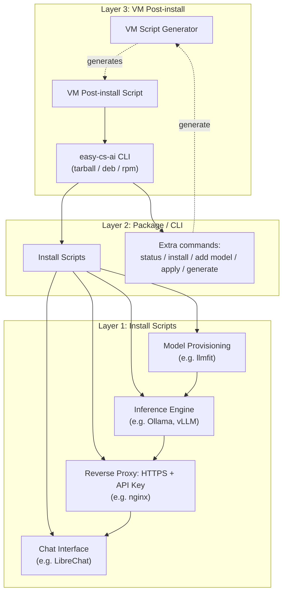

# All-in-one zero-conf local AI

This project is a toolbox that wraps the best open-source AI tools available out there.

> **Status: early development.** Most of this README describes the intended design. Only the shared library, the Ollama, llmfit and nginx install scripts, the CLI (`status`, `install`, `uninstall`, `add`, `remove`, `apply`, `generate`) and the VM script generator exist so far, none has been tested on a real VM, and the other components and the packaging are still missing. See [Roadmap](#roadmap) for what's built vs. planned.

Built on [Ollama](https://ollama.com), [llmfit](https://github.com/AlexsJones/llmfit) and [nginx](https://nginx.org). This project only wraps existing open-source tools; more are credited here as they are integrated.

## Features

Install AI models locally and access them through a web API with an API key.

Chat with your local AI models through a web interface.

Generate customized install scripts for your local server or your VMs (Virtual Machines).

## Requirements

Targeting Ubuntu/Debian, primarily for provisioning fleets of VMs sized with just the necessary resources. Other Linux distributions (`.rpm`, or the tarball with `bash` and `curl`) may work but are not a design target yet. Scripts are written in bash, see [docs/decision-scripting-language](docs/decision-scripting-language.md). Other design choices are listed in [docs](docs/README.md).

## Architecture

How the layers and components fit together:

Each layer wraps the previous one and can be used on its own: install scripts alone for a single server, the package/CLI for a self-contained bundle, or the VM post-install layer for provisioning fleets of VMs.

## Project Layout

- [install_scripts](install_scripts/README.md) — Layer 1: install-and-configure scripts
- [package](package/README.md) — Layer 2: package and CLI
- [vm_script](vm_script/README.md) — Layer 3: VM post-install script generator
- [search](search/README.md) — findings on candidate components and tools
- [docs](docs/README.md) — design decisions and write-ups
- [tests](tests/README.md) — tests validating scripts, package and VM provisioning
- [.github/workflows](.github/workflows/README.md) — CI workflows

## Components

### AI Inference Engines

Several AI inference engines are supported, in integration order (see [docs/decision-integration-order](docs/decision-integration-order.md)):

1. Ollama
2. vLLM

### Authentication

Some inference engines do not provide authentication nor HTTPS so a reverse proxy wraps them to provide HTTPS and an API Key access.

- nginx

### AI Model Provisioning

- llmfit

### Chat Interface Websites

In integration order, see [docs/decision-integration-order](docs/decision-integration-order.md):

1. LibreChat
2. AnythingLLM

## Layers

The project is organized by layers of increasing complexity. The previous layer is wrapped by the next one. Each layer can be used without the next ones.

### Install Scripts

Each component has an install script with some parameters to install and configure the component in one go. The scripts work on their own, without the CLI. There is no generator at this layer: chaining components and fixing their parameters is the job of the [configuration file](docs/spec-config.md) and `easy-cs-ai apply` (layer 2), see [docs/decision-vm-generator](docs/decision-vm-generator.md).

### Package / CLI

The `easy-cs-ai` CLI wraps everything in one package (tarball, `.deb` or `.rpm`). Each install-and-configure script is reachable from the CLI commands and each component's commands are mirrored by the CLI. It also includes the HTTPS and API Key wrapping.

Extra commands :

- `status`, listing what is currently installed and running
- `install`, installing a new component
- `add`, adding a new model in an inference engine, wrapping it with the reverse proxy if needed and adding it to the chat interface website
- `apply`, interpreting a [configuration file](docs/spec-config.md) (components, options, models) to make the machine match it
- `generate`, the interactive generator of the layer 3 (VM post-install) script; `generate --config-only` writes the configuration file only

See [docs/cli-commands](docs/cli-commands.md) for the full command reference and [docs/decision-packaging](docs/decision-packaging.md) for the packaging choices.

### Post-install script for VMs

A generator, run interactively by an administrator, produces the VM post-install script. The generated script is small and self-contained: it downloads the package from a pinned source (version and checksum fixed in the script, a mirror URL for restricted networks), embeds the configuration and hands it to `easy-cs-ai apply`. The package is downloaded rather than embedded because VM user-data is size-limited, see [docs/decision-vm-generator](docs/decision-vm-generator.md).

### Apache CloudStack integration

Not designed yet. Ideas to explore:

- initialize a VM with a proper provisioning
- show the AI model requests (is the model being used?)

## Roadmap

Planned work, in dependency order:

| Layer           | Item                             | Status      |
| --------------- | -------------------------------- | ----------- |
| Install scripts | Ollama install script            | Written, unit-tested, not yet tested on a VM |
| Install scripts | vLLM install script              | Not started |
| Install scripts | llmfit install script            | Written, unit-tested, run against the real binary (CPU-only), not tested on a VM |
| Install scripts | Reverse proxy (HTTPS + API key)  | nginx written and unit-tested, self-signed certificate only, not tested on a VM |
| Install scripts | LibreChat install script         | Not started |
| Package / CLI   | CLI dispatcher + tarball/deb/rpm | Dispatcher and tarball written and unit-tested; `.deb`/`.rpm` definition and release workflow written, not run yet |
| Package / CLI   | `status` command                 | Written, unit-tested |
| Package / CLI   | `install` command                | Written, unit-tested |
| Package / CLI   | `add` / `remove` model commands  | Written, unit-tested with fake components |
| Package / CLI   | `apply` command                  | Written, unit-tested with fake components |
| Package / CLI   | `generate` command               | Written (hands over to the generator) |
| VM post-install | Post-install script              | Written (emitted by the generator), unit-tested |
| VM post-install | Script generator (`generate`)    | Written, unit-tested |
