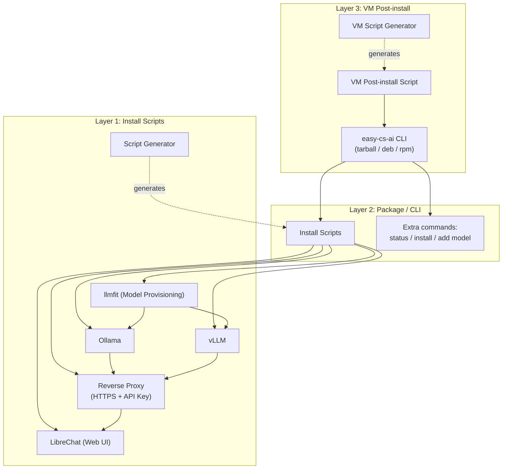

# All-in-one zero-conf local AI

This project is a toolbox that wraps the best open-source AI tools available out there.

> **Status: early planning.** Nothing is implemented yet — this README describes the intended design and roadmap, not a working tool. See [Roadmap](#roadmap) for what's built vs. planned.

## Features

Install AI models locally and access them through a web API with an API key.

Chat with your local AI models through a web interface.

Generate customized install scripts for your local server or your VMs (Virtual Machines).

## Requirements

Targeting Ubuntu/Debian, primarily for provisioning fleets of VMs sized with just the necessary resources. Other Linux distributions (`.rpm`, or the tarball with `bash` and `curl`) may work but are not a design target yet. Scripts are written in bash, see [docs/decision-scripting-language](docs/decision-scripting-language.md). Other design choices are listed in [docs](docs/README.md).

## Architecture

How the layers and components fit together:

Each layer wraps the previous one and can be used on its own: install scripts alone for a single server, the package/CLI for a self-contained bundle, or the VM post-install layer for provisioning fleets of VMs.

## Project Layout

- [install_scripts](install_scripts/README.md) — Layer 1: install-and-configure scripts
- [package](package/README.md) — Layer 2: package and CLI
- [vm_script](vm_script/README.md) — Layer 3: VM post-install
- [generators](generators/README.md) — script generators shared by the layers above
- [search](search/README.md) — findings on candidate components and tools
- [docs](docs/README.md) — design decisions and write-ups
- [tests](tests/README.md) — tests validating scripts, package and VM provisioning
- [.github/workflows](.github/workflows/README.md) — CI workflows

## Components

### AI Inference Engines

Several AI inference engines are supported:

- Ollama
- vLLM

### Authentication

Some inference engines do not provide authentication nor HTTPS so a reverse proxy wraps them to provide HTTPS and an API Key access.

- nginx

### AI Model Provisioning

- llmfit

### Chat Interface Websites

- LibreChat

## Layers

The project is organized by layers of increasing complexity. The previous layer is wrapped by the next one. Each layer can be used without the next ones.

### Install Scripts

Each component has an install script with some parameters to install and configure the component in one go.

A script generator helps you to generate parameterless install-and-configure scripts with fixed parameters.

### Package / CLI

The `easy-cs-ai` CLI wraps everything in one package (tarball, `.deb` or `.rpm`). Each install-and-configure script is reachable from the CLI commands and each component's commands are mirrored by the CLI. It also includes the HTTPS and API Key wrapping.

Extra commands :

- `status`, listing what is currently installed and running
- `install`, installing a new component
- `add`, adding a new model in an inference engine, wrapping it with the reverse proxy if needed and adding it to the chat interface website

See [docs/cli-commands](docs/cli-commands.md) for the full command reference and [docs/decision-packaging](docs/decision-packaging.md) for the packaging choices.

### Post-install script for VMs

Same as the install scripts but with the package/CLI. One script with some parameters to install and configure the package in one go and a generator script to generate some parameterless install-and-configure scripts with fixed parameters.

### Apache CloudStack integration

Not designed yet. Ideas to explore:

- initialize a VM with a proper provisioning
- show the AI model requests (is the model being used?)

## Roadmap

Planned work, in dependency order:

| Layer           | Item                             | Status      |
| --------------- | -------------------------------- | ----------- |
| Install scripts | Ollama install script            | Not started |
| Install scripts | vLLM install script              | Not started |
| Install scripts | llmfit install script            | Not started |
| Install scripts | Reverse proxy (HTTPS + API key)  | Not started |
| Install scripts | LibreChat install script         | Not started |
| Install scripts | Script generator                 | Not started |
| Package / CLI   | CLI dispatcher + tarball/deb/rpm | Not started |
| Package / CLI   | `status` command                 | Not started |
| Package / CLI   | `install` command                | Not started |
| Package / CLI   | `add` model command              | Not started |
| VM post-install | Post-install script              | Not started |
| VM post-install | Script generator                 | Not started |
