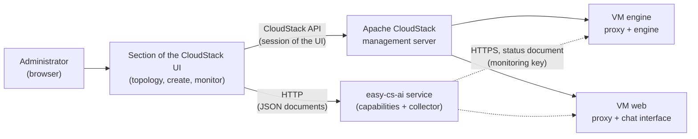

# Spec: Apache CloudStack integration, a page for a local AI topology

[← Back to docs](README.md)

**Status:** proposed, specification only. Nothing of this is written: no page, no service, no change to the scripts. **Decision:** the page is a **native section of the CloudStack UI, contributed to `apache/cloudstack`**, not a plugin loaded in an iframe (that would need a web server of its own to host the page, see [search/cloudstack](../search/cloudstack/ui-extension.md)); see [contributing to CloudStack](#contributing-to-cloudstack). It builds on specs that are themselves partly proposed (the [`links` and the editor of several VMs](spec-multi-vm.md)); what it needs from them is listed in [what it relies on](#what-it-relies-on). Every statement about Apache CloudStack itself (its API, its UI plugin mechanism, its limits) comes from memory of the documentation and **is to be verified** against the version targeted, see [to verify](#to-verify-on-cloudstack).

## Purpose

An administrator of an Apache CloudStack cloud wants a **local AI** (an inference engine, a chat interface, a reverse proxy, models) running on VMs of that cloud, with no tool to learn beyond the CloudStack UI. This spec adds **one page to the CloudStack UI** (a native section of that UI, contributed upstream) that does, from inside CloudStack, what the project does from a terminal:

1. **Define** a topology of VMs (for instance a `web` VM and an `engine` VM) and what each one holds: the [configuration](spec-config.md), with its [`vm` fields and `links`](spec-multi-vm.md).
2. **Create** the CloudStack resources that topology needs (VMs, disk, network rules, key pair…), each VM provisioned at first boot by the [post-install script](spec-vm-generator.md) the generator produces for it.
3. **Monitor**, specifically, what concerns the use of a local AI: are the engine and the chat interface up, which models are served, are they being used, is the VM big enough for them. The VMs and their disks are of course also listed in the usual pages of CloudStack: the page does not replace them, it adds the view that only this project can give.

The page is **a third rendering of the [journey](spec-journey.md)**, after the interactive session and the `--json` arguments (see [spec: renderings](spec-rendering.md)): it asks the same questions, calls the same capabilities, shows the same documents, and ends on the same configuration and the same scripts. It owns no rule.

> **A page decides how something is shown or asked, never what is true.** The components, options, dependencies, sizing, warnings, next steps and scripts are the capabilities' ([rule 4 of the journey](spec-journey.md#rules)). The page only adds what CloudStack alone knows: which resources exist and what they cost.

## Principles

1. **Same features as the project, no second logic.** Choosing components and options, dependencies, models checked and sized with llmfit, VMs and links, validation, warnings, the generated scripts and the next steps all come from the CLI capabilities (`catalog`, `config schema`, `config validate`, `provisioning llmfit plan`, `generate --config --json`), see [the service](#the-service). The page never recomputes a figure, a margin, a warning or a script. A change of a rule is a change of a capability, and improves the terminal and the page at once.
2. **One file describes the topology.** What the page edits and saves is the configuration of [spec: config](spec-config.md), the same file `generate --config` and `apply` read. A topology made in the page can be downloaded and run from a terminal, and a file written elsewhere can be loaded in the page ([parity](#definition-of-done)).
3. **The user decides, CloudStack is the authority on resources.** Nothing is created, resized or deleted without the person having seen the list and confirmed ([rule 3 of the journey](spec-journey.md#rules)). What exists in CloudStack is read from CloudStack, never from a copy of the page.
4. **Only what it created, and it marks it.** Every resource the page creates carries [tags](#tags); it lists, changes and deletes **only** tagged resources of the topology. A VM, a network or a volume that the user made by hand is never touched, even if it looks related.
5. **No secret in what the page stores or sends.** The user-data of a VM is stored in the CloudStack database and readable from the VM, so no secret goes there ([contract](spec-script-contract.md#secrets)): the keys are generated on the VMs and stay there. What the page keeps is limited to the [monitoring key](#reading-the-vms).
6. **Nothing the CloudStack permissions do not allow.** The page acts with the session of the user, through the API layer the UI already uses for every other page: a user who cannot deploy a VM cannot do it here. It adds no privilege and no authentication of its own towards CloudStack.
7. **Written the way CloudStack's UI is written.** The section follows the conventions of `ui/` of `apache/cloudstack` (its structure, components, translations, tests, licence), because it is meant to be merged there and kept by that community: nothing in it is specific to this repository except the capabilities it calls.

## What it relies on

| Needs | From | State |
| --- | --- | --- |
| Several VMs in one file, `links`, roles, one script per VM, next steps | [spec: several VMs](spec-multi-vm.md) | `vm` and scripts implemented, `links`, the editor and any number of VMs proposed |
| Sizing of each VM: vCPU, RAM, GPU, disk, "equivalent of a CloudStack compute offering" | [spec: model fit](spec-model-fit.md) (`plan`) | implemented |
| User-data size (32 KB, the default `vm.userdata.max.length`) | [spec: VM generator](spec-vm-generator.md) | the generator already warns |
| Capabilities as `--json` documents | [spec: capabilities](spec-capabilities.md) | implemented |
| Status of the components | [`status`](spec-cli.md#status), `component … status` | implemented |
| Reading the use of the models, from outside the VM | [the status document](#the-status-document) | **new, proposed here** |

## Architecture

Three pieces, each with one job:

| Piece | Job | Does not |
| --- | --- | --- |
| **The page** (a section of the CloudStack UI) | The screens: edit, confirm, create, watch. Calls CloudStack for resources and the service for everything about the AI | Hold any rule of the project; reach a VM itself |
| **CloudStack** (its API) | Own the resources: offerings, templates, networks, VMs, volumes, tags, metrics, jobs | Know anything about models |
| **The service** | Run the **capabilities of the CLI** (`--json`, no root, nothing installed on the machine it runs on) for the page, and **collect the status** of the VMs of a topology | Create resources, nor keep more than [what it needs](#what-the-service-keeps) |

### The page

A **section of the CloudStack UI**, with its own entry in the navigation next to the compute pages, written in the UI's own framework and built with it, reached by the users whose CloudStack role allows it. It is not a plugin and not an iframe: it uses the session, the API calls, the components, the notifications and the translations of the UI, and looks like its other pages. It lives in `apache/cloudstack` (see [contributing](#contributing-to-cloudstack)), not in this repository. Its three screens are the [topology](#screen-1-topology), the [creation](#screen-2-creation) and the [monitoring](#screen-3-monitoring). The page has a list of the topologies of the account first (found by their [tags](#tags)), with *new topology*, *import a file* and, for each one, *open*, *download the file*, *destroy*.

The section appears only when the cloud has a **service configured** (an entry of the UI configuration, name to settle with the CloudStack community): without it the page has nothing to call for the AI side and the menu entry is not shown. A cloud that does not use the project is unchanged.

### The service

The CLI is a program for a machine, not for a browser, and the capabilities are what the page needs: they already answer in JSON. The service is the **thinnest possible wrapper** of them over HTTP, so that the page can call them:

| Call | Runs | Document |
| --- | --- | --- |
| catalog | `easy-cs-ai catalog --json` | [spec: capabilities](spec-capabilities.md#catalog) |
| schema | `easy-cs-ai config schema` | idem |
| validate | `config validate <file> --target fresh --json` | idem, with `plan`, `warnings`, `next_steps` |
| plan a VM | `provisioning llmfit plan` (with `--component` and `<model>@<engine>`) | [spec: model fit](spec-model-fit.md#declared-resources) |
| suggest / check | `provisioning llmfit suggest`, `check`, with `--target-*` | idem |
| generate | `generate --config <file> --json` | the scripts and `next_steps` |
| collect | reads the [status document](#the-status-document) of each VM | [below](#reading-the-vms) |

- **The documents are passed through as they are.** The service adds no field, no rule and no text to them: a document that the CLI changes reaches the page changed. `guide.txt` is not involved (it is for a model that drives the CLI).
- **It runs the same package as the VMs.** Its version is the one the generated scripts pin (see [package source](spec-vm-generator.md#package-source)), so the page never proposes what a VM cannot install.
- **It needs no root and changes no machine**, as the generator: capabilities that only read or compute. `provisioning llmfit` must be installed where it runs for sizing to work, otherwise the page says the recommendation is not available, as the session does (see [llmfit is optional](spec-model-fit.md#llmfit-is-optional)).
- **Where it runs** is an operator's choice (the host of the management server, or any machine that the browser can reach and that can reach the VMs for the [collection](#reading-the-vms)); its address is the one setting of the UI configuration above. Since the page is hosted by CloudStack and the service is not, the browser calls a **second origin**: the cross-origin rules (and the authentication of the calls, see the [first open question](#open-questions)) are part of the design, not an afterthought.

#### What the service keeps

As little as possible, and nothing that CloudStack already has:

- **Nothing about the topology.** The configuration is passed with each call. See [where a topology lives](#where-a-topology-lives).
- **The monitoring keys** of the topologies, needed to read the VMs (see [reading the VMs](#reading-the-vms)), and the certificate that each VM's proxy presents (public). Nothing else is persisted, in particular no history of the status.
- Secrets are never in logs, as everywhere in the project.

## Contributing to CloudStack

The page is built **in the repository of Apache CloudStack** and proposed there, so that it ships with the UI. This splits the work between two repositories:

| Where | What lives there |
| --- | --- |
| **`apache/cloudstack`** (`ui/`) | The section: its routes and menu entry, the three screens, the calls to the CloudStack API, the calls to the service, the translations, the tests of the UI, and the documentation of the feature in the CloudStack docs |
| **This repository** | The CLI and the capabilities the page shows, the **service** that exposes them over HTTP, the [status document](#the-status-document) of the proxy, the specs (this one included), and the tests of all of these |

What this implies, to settle with the CloudStack community **before** writing the page:

- **The community has to accept a section whose AI part depends on an external service** that is not part of CloudStack. The proposal is the one above: the section is shown only when the service is configured, and nothing else of CloudStack depends on it. If the community refuses an external dependency, the alternatives are a section limited to what CloudStack knows (resources and metrics, [without the AI side](#not-in-this-version)), the [extensions framework](../search/cloudstack/ui-extension.md#options) for actions on VMs, or the logic moved into CloudStack's Java server, which breaks [principle 1](#principles) and is not proposed.
- **The process of the project is followed**, not invented here: a discussion and a proposal on its mailing list or issue tracker before a large change, a pull request against the main branch, the project's licence headers, and its release cycle (the section reaches a release when it is merged for it). Where those rules are written is in the project's contribution guide, to read first ([to verify](#to-verify-on-cloudstack)).
- **The page is developed against a CloudStack that exists**: a development environment of the UI, pointed at a test management server, and a fork of the repository for the branch. Nothing here needs the project's own page to be installed on a production cloud before the merge.
- **The version it targets** is the main branch at the time, and a release later. A cloud on an older version does not have the page; the service and the CLI work without it.
- **The page stays thin** ([principle 1](#principles)): the less logic the section holds, the less there is to review, translate and maintain upstream, and the less it moves when a capability of this repository changes.

## Screen 1: topology

A topology is edited as the [editor of spec: several VMs](spec-multi-vm.md#editing) does, with the same operations, as forms instead of a prompt:

| Part of the page | What it is | Capability and rule it shows |
| --- | --- | --- |
| **VMs** | A list; *add a VM* with a name (shape of [spec: config](spec-config.md#several-vms)) and an optional role (`engine`, `web`, `custom`, only a shortcut), rename, remove (with what goes with it announced) | [roles](spec-multi-vm.md#roles), `vm` fields |
| **Components of a VM** | One selector per type with the shipped components and their rank, the dependencies a choice drags in listed and accepted explicitly, the options as typed fields (a secret option offers its channels only, never a value) | `catalog`, `config schema`, [step 2 and 3 of the journey](spec-journey.md#2-components-and-dependencies) |
| **Models of an engine** | Hardware first (the specs of the VM, a ranked list of models that fit) or models first (the VM they need), each model with its fit verdict and the warning when llmfit disagrees; the place of a model is its VM and engine | [spec: model fit](spec-model-fit.md#choosing-models-in-a-session) |
| **Links** | For each VM that has a chat interface, the VMs whose engines it lists; the page draws them | [`links`](spec-config.md#links) |
| **Sizing of each VM** | The recommendation of `plan` for that VM, memory in two quantisations, the **estimated margin** shown as such with its sources, the models not covered, never a single total that looks measured | [estimated margin](spec-model-fit.md#estimated-margin) |
| **Warnings and errors** | Those of `config validate`, each with its `vm` and path, and the fix proposed as the editor's `f` does; **nothing can be created while an error stands** | [validation](spec-multi-vm.md#validation) |
| **File** | *Download* and *import* of the configuration | [spec: config](spec-config.md) |

Specifics of CloudStack at this screen, all asked as part of the same step, never decided silently:

- **Which CloudStack resources a VM maps to** (the [mapping](#mapping-to-cloudstack-resources)) is shown next to the sizing and is editable there: this is where the user turns "8 vCPU, 24 GB" into an actual compute offering, the zone, the template and the network. These choices are about CloudStack and are **not** part of the configuration file (the file stays valid for any cloud, like the target specs of the models step: an early opinion, see [spec: model fit](spec-model-fit.md#model-fit-for-a-machine-that-is-not-this-one)). Where they are kept is in [where a topology lives](#where-a-topology-lives).
- **A VM with a GPU** is offered only with a GPU compute offering the account can use, and the sizing is asked in GPU memory.
- **The size of a generated script** is shown per VM against the user-data limit of the cloud, which the page reads from CloudStack ([to verify](#to-verify-on-cloudstack)); above it, the VM cannot be created and the page says so before creation, not after.

## Mapping to CloudStack resources

For every VM of the configuration, the page proposes, from the sizing and the CloudStack inventory, the items below. **Every line is a proposal the user can change.** The page reads what the account may use (it lists, it does not guess).

| Needed | Proposed from | CloudStack object |
| --- | --- | --- |
| Compute (vCPU, RAM, GPU) | The sizing of `plan` for the VM: RAM without GPU or GPU memory with one, whichever applies, the cores of the `h` order if given | The smallest **compute offering** that covers it, or a custom one when the offerings allow it; none large enough is said, not worked around |
| Disk | The disk of `plan` (models plus system plus components) | The root disk size at deployment, or a data disk for the model store, per the offering rules of the cloud |
| Image | Ubuntu 24.04 or Debian, the targets of the project | A **template** the account may use, which must support cloud-init user-data; the user chooses, the page only filters by its name and OS type |
| Boot script | `generate --config` (one script per VM, with the `VM:` header) | The **user-data** of the VM, base64, verified against the limit |
| Network | One network for the topology | An existing network of the account, or, if the user asks, a new isolated network (the page proposes, never creates a network silently) |
| Reachability | The ports the stack uses: 443 for each proxy (the engine VM's too: the web VM reaches it there), 8443 for the chat interface, 22 for SSH | Security-group rules or firewall and port-forwarding / static NAT rules, **depending on the kind of network**; and the rule that lets the `web_vm` of a link reach the `engine_vm` on the HTTPS port of its proxy ([next step 3](spec-multi-vm.md#next-steps)). The page lists each rule before creating it |
| Access | | An existing **SSH key pair** chosen by the user (the page does not create credentials) |
| Order | `links` | The engine VMs are deployed first, as the [next steps](spec-multi-vm.md#next-steps) say |

A rule of the project is kept: a model's engine listens on the loopback and only its proxy is exposed, so **no rule ever opens the engine's own port** (11434 for Ollama).

## Screen 2: creation

*Create* is a button on a topology with no error. It does nothing before showing the **plan of creation**: the exact list of what will be created, per VM, with the offering, template, disk, network, rules and tags, the size of each user-data, and a clear notice of what costs (the compute offerings, the public IPs). Only the user's `Create` after that list starts anything.

Then, in order, each step shown with its state and its CloudStack job:

1. The tags, the SSH key and the network items chosen (only what was not there).
2. The security-group, firewall or port-forwarding rules.
3. The VMs, engine VMs first, each as a CloudStack asynchronous job whose progress the page follows. The user-data is the script of that VM.
4. The VMs come up and **run their script at first boot** (cloud-init), which installs the stack. The page moves to the monitoring screen and shows this phase as [bootstrapping](#states-of-a-vm), because it takes minutes and models are downloaded in it.

Rules:

- **Idempotent and resumable.** The page finds what already exists by the [tags](#tags) and creates only what is missing, so that a failure in the middle, a closed tab or a second click leaves nothing doubled: *create* again continues. It never creates a second VM for a name that already exists in the topology.
- **A failure stops at that step**, says which job failed with the CloudStack error as given, and **removes nothing on its own**: the user chooses *retry*, *continue without*, or *destroy what was created* (listing it first).
- **The links are finished by hand once the VMs are up**, as today ([principle 3 of spec: several VMs](spec-multi-vm.md#principles)): the address of an engine VM and its API key do not exist when the scripts are generated, and no secret may travel through the user-data. The page shows the [next steps](spec-multi-vm.md#next-steps) of the validation, as written, **per link, with the real VM names, as a checklist**, and the [monitoring](#links-state) tells when each one is done. It does not run them: reaching inside a VM is beyond what the CloudStack API gives. A higher-level command that finishes a link is the [open question](spec-multi-vm.md#open-questions) of spec: several VMs, and would serve the page directly.
- **Editing after creation.** A script is a snapshot, so changing the configuration of a VM that exists is not changing the VM. The page offers, for an existing topology: add a VM (created like the others), and, for a change of a VM that exists, the **command to run on it** (`easy-cs-ai apply`, with the new slice) instead of silently recreating anything. It shows the drift between the file and what the VMs report ([states](#states-of-a-vm)). Replacing a VM is a destroy and a create, announced as such.
- **Destroy** a topology lists the tagged resources, asks whether to expunge (CloudStack's own choice) and whether to delete the data disks, and deletes nothing untagged. It is never offered on a resource created by hand.

## Tags

Every resource created by the page carries [CloudStack resource tags](#to-verify-on-cloudstack), the only link between a topology and CloudStack (the page has no database):

| Key | Value |
| --- | --- |
| `easy-cs-ai.topology` | The name of the topology (a string of the shape of a [VM name](spec-config.md#several-vms)) |
| `easy-cs-ai.vm` | The name of the VM in the configuration, on the VM, its volumes and its rules |
| `easy-cs-ai.version` | The version of the package the scripts pin |

A resource without the topology tag is not part of it. Tag values are short and hold **no secret and no configuration**. A user may remove a tag by hand: that removes the resource from the topology, which is shown (the VM then appears as *not found* where it was expected), never guessed back.

## Where a topology lives

The page has no database of its own, and the service keeps no topology. The configuration must live somewhere the user's account can reach, survive a closed tab, and be shared between the users of the account. The choices:

| Option | For | Against |
| --- | --- | --- |
| The browser only (draft) plus *download* | Nothing to build | Lost with the browser; not shared |
| A CloudStack object of the account (a stored user-data template, or annotations on a resource) | Follows the account's permissions; visible to those who see the VMs | Depends on a CloudStack feature and its size limits; to verify |
| The service | Simple | A second source of truth next to CloudStack, to protect and back up |

**Proposed:** a draft in the browser while editing, then the configuration saved **in CloudStack** (the first row of the second option) when the topology is created, found back by its tags; the file stays downloadable at any time. The configuration holds no secret by [rule](spec-config.md#secrets), so it can sit there. The choice depends on what the CloudStack version allows, see [open questions](#open-questions).

## Screen 3: monitoring

A page per topology, built around one question: **is the local AI there, and is it used?** It is a dashboard of **status**, not a metrics system: it shows the state now and a short trend, and keeps no long history (the service keeps none, see [what it keeps](#what-the-service-keeps)).

### Sources

| What | From | Reach |
| --- | --- | --- |
| The VM exists, its state, offering, addresses, its job | CloudStack API (`listVirtualMachines`) | Always |
| CPU, memory, disk and network of the VM | CloudStack's own metrics of the VM | Always |
| What runs inside: components, models, links, use of the models | The [status document](#the-status-document) of the VM | Through the service, when the VM answers |

CloudStack tells **what the hypervisor sees**. Only the VM knows whether the engine answers, which models it holds and whether anyone is using them. The two are shown side by side and never merged into one verdict: a VM `Running` in CloudStack whose engine is down is the most useful thing the page can show.

### What it shows

**Header of the topology**: the overall state (the worst of the VMs, with the reason), the number of VMs, the models, and the age of the data ("updated 12 s ago") with a refresh control. A stale or missing source is shown as such, never as the last value.

**Per VM** (one card, `engine` and `web` here):

| Block | Content | Source |
| --- | --- | --- |
| State | One of the [states](#states-of-a-vm) | CloudStack and the status document |
| Components | Each installed component, with `running` and `healthy` (what `easy-cs-ai status` gives) | Status document |
| Resources against the plan | vCPU, RAM, disk in use against what the VM has, and **against what `plan` recommended for its models**: the page flags a VM whose RAM or disk use approaches the limit; the figures are the CloudStack ones, the recommendation is the capability's, and the margin is described as an estimate | CloudStack and `plan` |
| Certificate | The names it covers and its expiry (a self-signed certificate does not expire the same way as Let's Encrypt) | Status document |

**Per model** (a table across the VMs, each model with its [place](spec-config.md#where-a-model-goes)):

| Column | Meaning |
| --- | --- |
| Model, engine, VM | The place of the model |
| Loaded | Whether the engine reports it served (the [state of the engine](spec-script-contract.md#type-specific-actions)) |
| Use | **in use** (a request in the last 5 minutes), **idle** (none since, the last one dated), **never used** (none since the topology was created, or since the data starts) |
| Requests | Count over 5 minutes, 1 hour, 24 hours |
| Errors | Share of requests that were not answered successfully over the same windows |
| Latency | Typical and slow (median and 95th) over the last hour, when the proxy records it |
| Reached from | The chat-interface VMs whose [link](#links-state) lists it |

"**Never used**" and "**idle for a long time**" are what lets an administrator see that a costly GPU VM serves nothing. The thresholds are options of the page with these defaults, not rules of the project.

#### Links state

Each [link](spec-config.md#links) of the configuration is shown as `web → engine` with one of: **to do** (the `web_vm` reports no endpoint for the models of the `engine_vm`: the [step 4](spec-multi-vm.md#next-steps) is not done), **done** (the endpoint is in place), **broken** (it is in place but the `engine_vm` is not reachable from the `web_vm`, or the model list is empty). Each *to do* carries its checklist from the [next steps](spec-multi-vm.md#next-steps). Until a link is done, the model list of the chat interface is empty, which the page says in plain words.

#### States of a VM

One state per VM, the first that applies, each with what to do:

| State | Means |
| --- | --- |
| **Not found** | A VM of the configuration with no tagged VM in CloudStack (creation not done, or the tag removed) |
| **Stopped / Error** (as CloudStack's) | The hypervisor's state, shown as it is |
| **Bootstrapping** | Running in CloudStack, the [status document](#the-status-document) not available yet (cloud-init running, the script installing, a model downloading). Normal for several minutes; the page shows the time elapsed and says when it is long |
| **Unreachable** | Was reachable, no longer answers (firewall, proxy down, VM overloaded) |
| **Degraded** | Reachable, at least one component not running or not healthy, or a model not served |
| **Ready** | Reachable, every component of the configuration healthy, every model served |
| **Drifted** | `Ready`, but what the VM reports differs from the configuration (a component or a model added or removed by hand): shown, not "fixed" |

#### Alerts

Short and about the AI, not generic monitoring: an engine down, a model not served, a link broken or to do for more than a time, a certificate near its expiry, RAM or disk near the limit for the models held, a GPU VM whose models are never used. Alerts are shown on the page. Sending them anywhere (mail, CloudStack events) is [not specified](#open-questions).

### Reading the VMs

CloudStack's API does not look inside a VM, and neither the page nor the service may log in to one. The project adds a **read-only status** that a VM publishes itself, and the service reads it.

#### The status document

Proposed, to add to the proxy component and its contract (**not implemented**): a document, refreshed by the VM every minute (a timer, **no new daemon**), served by the reverse proxy that already exposes the VM over HTTPS at a fixed path of its own (`/easy-cs-ai/status.json`), **never at a path of a model**. It is one JSON document, with its own `schema_version`, that holds only what is not secret:

| Field | Content |
| --- | --- |
| `vm`, `generated_at`, `package_version` | Who and when; `vm` is the name in the configuration when the slice carried it, else the host name |
| `components[]` | What `easy-cs-ai status --json` gives: name, type, version, `running`, `healthy` |
| `models[]` | Per model: name, engine, `served`, and the **use** of the model: requests and errors over 5 minutes, 1 hour and 24 hours, the date of the last request, latency (median, 95th). Counted from the **proxy's access log**, per model location, so that no engine is modified and every engine is covered alike |
| `endpoints[]` | For a chat interface, the endpoints it lists (name, model, URL), no key: it is what says a [link is done](#links-state) |
| `certificate` | The names it covers and its expiry |
| `system` | Free disk of the model store, memory seen by the VM |

- **It never holds a secret, a prompt or an answer.** The access log is read for counts, status codes, times and the model location only: the content of a request is not in the log and is never read. A log is not kept longer than the counters need.
- **It is read-only and read with a key of its own**, the **monitoring key**: generated on the VM at install like the API key, stored under `/etc/easy-cs-ai/secrets/`, accepted **only** on the status path, and useless for inference. The API key is never the monitoring key, so a leak of the monitoring key leaks no access to the models. It is read on the VM with `component proxy nginx show-key` (a second key, named in [open questions](#open-questions)), as the API key is.
- **A VM with no proxy** (no shipped stack, a proxy is required as soon as an engine holds a model) has no status document and is shown as `Unreachable`-by-design: only the CloudStack part is shown for it, and the page says so.
- The document is a capability of the VM, usable without CloudStack: `easy-cs-ai status --json` stays the local, root-free way, and the document is its remote form.

#### How the service reads it

- The service reads each VM's status over **HTTPS with the monitoring key**, on the address CloudStack gives for the VM (the VM's IP or the public IP and port of its rule) and the certificate recorded for the VM, **verified against it** (never switched off, as for `--ca-file` in the [contract of the link](spec-multi-vm.md#chat-interface-librechat-add-endpoint)). The first time, the user is shown the certificate's fingerprint and its names and accepts it, as for an SSH host.
- **The monitoring key reaches the service once, given by the user** (read on the VM, pasted in the page, as the API key is read for the links). The page says where to read it, and the key never goes through the user-data. It is stored by the service for that topology ([what it keeps](#what-the-service-keeps)), nowhere else.
- Polling is on demand and bounded: while a monitoring page is **open and visible**, every 30 seconds by default, never faster than the VM refreshes its document, and **not at all** when no page is open. A failed read is a state, not an error to hide, and is never retried in a tight loop.
- The service reads only VMs of the topologies whose tags and monitoring key it was given, on the addresses CloudStack reports for them (it is not an open fetcher: the URL is never given by the page).

## Security

- The page uses the user's CloudStack session and API rights. The service is a second door: whatever it accepts, it must reject a caller that is not an authenticated user of the page (first open question), and it only reads and computes.
- No secret in the configuration, the user-data, the tags, the status document or the logs. The only stored secrets are the monitoring keys, on the service, mode `0600` or in the service's secret store.
- Data of the models (prompts, answers) never leaves the VMs and is never read by the status collection.
- The service never opens connections to addresses the user did not get from CloudStack for the topology (no request forgery).
- Destruction is only of tagged resources, after a listed confirmation.

## Not in this version

- **GPU set-up inside the VM** (drivers, passthrough): the scripts do not do it today and the project has not tested a GPU yet; the page offers a GPU offering and sizes for it, it does not make the VM able to use it.
- **Metrics history, dashboards of long periods, billing** and alerts sent out: the CloudStack usage and events services, or any monitoring tool, are the place.
- **Kubernetes, autoscaling, load balancing** several engine VMs for one model.
- **Replacing the CloudStack pages** (VMs, volumes, networks): the resources stay there, the page links to them.
- **Several clouds or several CloudStack zones in one topology.** A topology lives in one account of one CloudStack, in one zone.
- **Finishing the links automatically** (see [creation](#screen-2-creation)).

## To verify on CloudStack

The first reading of the documentation is in [search/cloudstack](../search/cloudstack/README.md) (2026-11-06, read and not tried): it confirms that a UI `plugins` entry shows a page in an iframe, that tags and registered user-data exist, and that the user-data limit counts **after base64** (about 24 KB of script, not 32 KB). The points below remain to check on a real instance of the version targeted; each is a premise, none is relied on as fact:

- **How a section is added to the UI and what the contribution requires**: the structure of `ui/` (sections, router, components, translations, tests), the version of its framework, the contribution guide and the proposal process of the project, whether a section may depend on an external service, and what the community expects for a feature of this size. [search/cloudstack](../search/cloudstack/ui-extension.md) found the way to add a section (`src/config/section`, `src/config/router.js`) in the UI guide only.
- **Resource tags** on VMs, volumes, networks and rules, their key and value limits, and that a tag on a rule or a network exists as needed.
- **Stored user-data / annotations** as a place for the configuration ([where a topology lives](#where-a-topology-lives)): availability, size limits, permissions.
- The **user-data size limit** (`vm.userdata.max.length`, default 32 KB per the [generator spec](spec-vm-generator.md#implementation-notes)) and how to read it from the API.
- **Metrics** of a VM through the API (CPU, memory, disk, network) and their freshness.
- **Networks**: what the account may create, and the differences between an isolated network (firewall and port forwarding), a shared one with security groups, and an advanced zone's VPC, for [reachability](#mapping-to-cloudstack-resources).
- **Compute offerings** with GPU and custom offerings, and the filtering of templates by the account.
- The **cloud-init** behaviour of the target templates, including the persistence of the journal ([contract open question](spec-script-contract.md#open-questions)).

## Definition of done

- A **parity** test, as that of the [journey](spec-journey.md#parity): the same decisions made in the page (against a fake service) and written by hand give the same configuration, the same validation document and the same scripts; a configuration downloaded from the page and one loaded into it are byte for byte the same.
- Tests of the **service** with the real CLI and fake components: each call gives exactly the CLI's document (no field added, no field dropped); no root needed; a changed document of the CLI reaches the caller unchanged.
- Tests of the **creation**, against a CloudStack API simulator or a mock: the plan lists exactly what is created and nothing that exists; it starts nothing before confirmation; the engine VMs are deployed first; a re-run after a failure at each step creates only what is missing; a failure removes nothing; an untagged resource is never listed for destruction nor touched; the user-data is the generated script and above the limit the creation is refused before any call; no secret in the user-data, the tags or the requests.
- Tests of the **status document** (proxy, `EASY_CS_AI_ROOT` mode): fields, counts from a sample access log per model, no content of requests, a refresh by the timer with no daemon, the monitoring key accepted on the status path only and refused on a model path, the API key refused on the status path, the document absent for a VM with no proxy.
- Tests of the **collection**: a self-signed certificate verified against the recorded one and refused when it changes; the states of a VM for each case of the [table](#states-of-a-vm); the use classes (`in use`, `idle`, `never used`) at their thresholds; no polling when no page is open; a failed read shown as such.
- An **integration test** on a CloudStack (or its simulator): a topology of an engine VM and a web VM created from the page, scripts run at first boot, the links done by hand following the checklist, then the page showing `Ready`, the links `done` and the models as `in use` after a request, and `never used` before it.
- The section **meets the conventions of `apache/cloudstack`**: it builds with the UI, passes its checks and tests, has its translations and its documentation, and is merged upstream; the work done in this repository is limited to the capabilities, the service and the proxy.
- `docs/` and the README in step with the page's real behaviour.

## Open questions

- **Authentication of the page to the service.** The service must accept only authenticated users of the CloudStack of the account. The page has the user's session, but the service is another origin: either the service checks the session (or a signature of the user's keys) against the management server on each call, or CloudStack gives the page a short-lived token. The first needs the service to reach the management server and the session to be sent cross-origin; the second needs something CloudStack does not offer today. Not specified, and the first thing to settle with the community.
- **The acceptance of an external service by the CloudStack community** ([contributing](#contributing-to-cloudstack)), and the alternatives if it is refused.
- **Where the service runs and who owns it.** A component of the management server host, a VM of the cloud, or one per account. It decides who holds the monitoring keys and how they are protected.
- **Where the configuration is saved** ([where a topology lives](#where-a-topology-lives)): depends on what CloudStack offers.
- **The monitoring key** is a **second secret per proxy**, a change to the [contract](spec-script-contract.md#secrets) (`show-key` gains a name, or a second action) and to the proxy's [state and options](spec-state-format.md). An alternative that avoids a second key: the status document readable without a key but **only from the address of the service**, which a firewall rule of the topology allows; it trades the key for a network rule and is weaker if the network is shared.
- **A path outside the proxy** for the status of a VM whose proxy is down: the VM can then only be `Unreachable`, with the CloudStack side. Is a guest-agent route worth the dependence on the hypervisor?
- **Metrics from the proxy's log** count requests, not tokens or GPU load. Whether the engines can report more (tokens per second, GPU use) in a way common to every engine, without breaking the rule that an engine is not modified, is open; vLLM and Ollama have their own metrics, and a type-specific action of the [contract](spec-script-contract.md#type-specific-actions) would be the way.
- **Sending alerts** (CloudStack events, mail, a webhook).
- **A credentials file** ([contract, Secrets](spec-script-contract.md#secrets)) for the API key and the monitoring key: it would let a tool in the cloud fetch them without the logs, but it is a secret in a file at a known place, readable by whoever reaches the VM; it must still be settled with the page, and the page does not depend on it (the user pastes the keys).
- **Roles in the page.** Whether a read-only user (watching the topologies, not creating) is a CloudStack role distinct from the one that creates, and how the page reads it.
- **Cost display.** Showing the cost of a VM from the offering, if the cloud publishes it, is outside what the capabilities give; the page would read CloudStack, never compute it.
